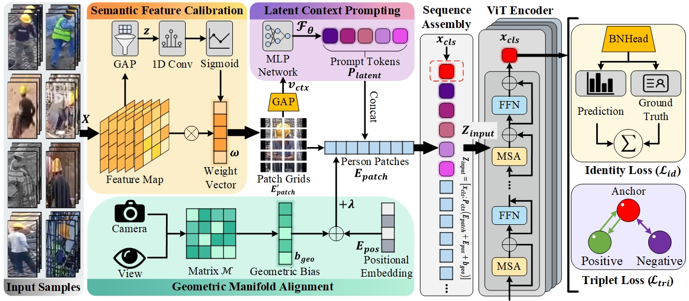

<div align="center">

# 🏗️ Con-ReID

**Unified framework for robust Person Re-Identification in complex construction environments**

Hongbin Liu · Peng Dong · Xiuyi Guo · Jilong Li · Yitong Zhou · Baoxu Wang

[](https://doi.org/10.1016/j.autcon.2026.107253)
[](https://doi.org/10.1016/j.autcon.2026.107253)
[](#-the-con-reid-dataset)
[](https://www.python.org/)
[](https://pytorch.org/)
[](./ISGAViT-main/ISGAViT-main/LICENSE)

[Overview](#-overview) · [Dataset](#-the-con-reid-dataset) · [Results](#-main-results) · [Quick start](#-getting-started) · [Citation](#-citation)

</div>

<p align="center">
  
</p>
<p align="center"><sub><b>ISGA-ViT</b> — Semantic Feature Calibration (SFC), Latent Context Prompting (LCP) and Geometric Manifold Alignment (GMA) for person ReID on construction sites.</sub></p>

<div align="center">

| 🖼️ Images | 🧍 Identities | 📷 Cameras | 📐 Crop size | 🏷️ Scenes |
|:---:|:---:|:---:|:---:|:---:|
| 13,130 | 154 | 6 | 64 × 128 | construction sites |

</div>

---

## 📰 News

- **2026** — The paper is published in *Automation in Construction* (Vol. 192, 107253).
  DOI: [10.1016/j.autcon.2026.107253](https://doi.org/10.1016/j.autcon.2026.107253)
- **2026** — Code of **ISGA-ViT** and the **Con-ReID** dataset are released in this repository.

## 🔍 Overview

Person ReID on construction sites is hard for reasons that have little to do with
the benchmarks the field usually uses: almost everyone wears the same safety
uniform, targets are far away and low-resolution, cameras are mounted at
irregular angles with large blind spots, and illumination changes abruptly. The
paper proposes **ISGA-ViT**, a framework that addresses the three difficulties
separately and without manual scene labels.

| Module | Role | What it does |
|---|---|---|
| 🧹 **SFC** — Semantic Feature Calibration | feature denoising | Suppresses the "identical safety vest" shortcut and forces the model to keep identity-specific evidence. |
| 💡 **LCP** — Latent Context Prompting | label-free scene adaptation | Infers the scene context (occlusion, pseudo-infrared, distance) and generates prompts that modulate the transformer attention. |
| 📐 **GMA** — Geometric Manifold Alignment | geometry correction | Learnable camera and viewpoint embeddings compensate the strong perspective distortions of irregular camera networks. |

## 🏙️ The Con-ReID Dataset

Existing ReID datasets are collected on campuses or city streets. **Con-ReID**
was recorded on operating construction sites, so it contains the nuisances that
matter in that setting: identical uniforms, heavy occlusion, distant
low-resolution targets and pseudo-infrared frames.

### Statistics as reported in the paper

| Subset | Identities | Images | Purpose |
|---|:---:|:---:|---|
| **Train** | 91 | 8,844 | optimisation |
| **Query** | 30 | 102 | probes to be re-identified |
| **Gallery** | 33 | 4,184 | reference database |
| **Total** | **154** | **13,130** | 6 cameras |

- **Cameras**: 6, covering front, back, side and top-down views.
- **Image size**: standardised to `64 × 128`, zero-padded to preserve the aspect ratio.
- **Challenges**: heavy occlusion, low resolution, pseudo-infrared (cross-modality) frames.

### Repository layout

```
ConReID-Dataset/
├── con-reid/
│   ├── bounding_box_train/     training crops
│   ├── bounding_box_test/      test crops
│   ├── query/                  query crops
│   └── gallery/                gallery crops
└── ISGAViT-main/               ISGA-ViT source code
```

File names follow the Market-1501 convention,
`{pid:04d}_c{cam}s1_{frame:06d}.jpg`, so the standard ReID data loaders work
without modification. The `_1` suffix denotes the horizontally flipped copy of a
crop. Please use the split defined in the paper when reporting numbers.

## 🏆 Main results

Multi-scene joint training, as reported in the paper:

| Dataset | mAP (%) | Rank-1 (%) |
|---|:---:|:---:|
| **Con-ReID (ours)** | **89.6** | **97.3** |
| Market-1501 | 80.6 | 92.3 |
| MSMT17 | 42.1 | 66.2 |
| MLR-CUHK03 | 87.2 | 91.9 |
| Occ-Duke | 59.7 | 72.9 |

Ablations, single-scene results and the per-module analysis are in the paper.

## 🚀 Getting started

### 1 · Requirements

- Linux (Ubuntu 22.04 recommended)
- Python ≥ 3.8, PyTorch ≥ 2.0 (CUDA 12.1 recommended)

### 2 · Code and dependencies

```bash
git clone https://github.com/dongpeng011/ConReID-Dataset.git
cd ConReID-Dataset/ISGAViT-main/ISGAViT-main
pip install -r requirements.txt
```

### 3 · Data preparation

Download the Con-ReID crops from this repository and arrange them next to the
public benchmarks:

```
ISGAViT-main/
├── data/
│   ├── Con-ReID/
│   │   ├── bounding_box_train/
│   │   ├── bounding_box_test/
│   │   ├── query/
│   │   └── gallery/
│   ├── market1501/
│   └── msmt17/
├── configs/
└── train.py
```

Update the dataset root in the configuration file you use.

### 4 · Training and evaluation

```bash
# train on Con-ReID
python train.py --config_file configs/con_reid.yml MODEL.DEVICE_ID "('0')"

# evaluate a checkpoint
python test.py --config_file configs/con_reid.yml MODEL.DEVICE_ID "('0')" \
    TEST.WEIGHT /path/to/best_model.pth
```

## 🙏 Acknowledgement

The code base is built on [TransReID](https://github.com/damo-cv/TransReID) and
[VersReID](https://github.com/iSEE-Laboratory/VersReID). We thank the authors for
releasing their work.

## 📚 Citation

If you use the Con-ReID dataset or the ISGA-ViT code, please cite:

```bibtex
@article{liu2026unified,
  title   = {Unified framework for robust Person Re-Identification in complex
             construction environments},
  author  = {Liu, Hongbin and Dong, Peng and Guo, Xiuyi and Li, Jilong and
             Zhou, Yitong and Wang, Baoxu},
  journal = {Automation in Construction},
  volume  = {192},
  pages   = {107253},
  year    = {2026},
  doi     = {10.1016/j.autcon.2026.107253}
}
```

**Plain text** — Liu, H.; Dong, P.; Guo, X.; Li, J.; Zhou, Y.; Wang, B.
*Unified framework for robust Person Re-Identification in complex construction
environments.* Automation in Construction **2026**, 192, 107253.
https://doi.org/10.1016/j.autcon.2026.107253

## 📧 Contact

Questions, bug reports and requests for the full-resolution dataset:
**liuhongbin19@sdjzu.edu.cn** or open an issue.

## 📄 License

The code is released under the MIT License (see
`ISGAViT-main/ISGAViT-main/LICENSE`). Please contact us before redistributing the
dataset images.
